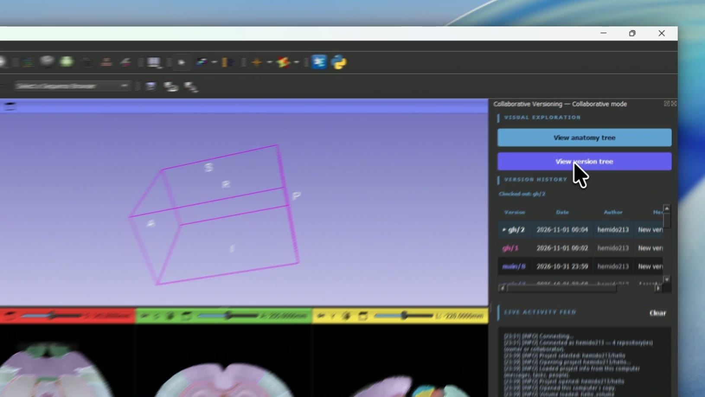
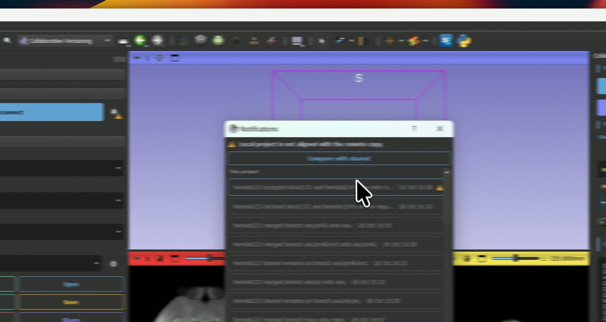

  
  
Extension <strong>3D Slicer</strong> pour versionner et partager des annotations en équipe.

---

## À quoi ça sert ?

Tu travailles dans Slicer sur un projet partagé. Chacun a une copie sur son ordinateur. Les versions validées et partagées vivent sur GitHub. L’extension affiche un **Version tree** (graphe de versions) : tu vois l’historique, tu changes de version, tu enregistres, tu partages, tu merges, tu assignes des tâches.

En résumé :
- **Save** = enregistrer une version **ici** (sur ta machine)
- **Share** = publier sur le projet partagé
- **Compare with shared** = te synchroniser quand d’autres ont avancé
- **Tasks** = le senior donne du travail aux juniors, avec review

---

## Ce qu’il te faut

- 3D Slicer avec cette extension chargée
- **Git** et **GitHub CLI (`gh`)** installés et accessibles
- Un compte GitHub (idéalement un senior + un ou deux juniors pour tester)

---

## Rôles

| Rôle | Ce que tu fais |
|------|----------------|
| **Owner / senior** | Crée le projet, invite les gens, assigne les Tasks, Share / Merge vers `main`, Accept ou Decline les reviews |
| **Junior** | Travaille sur les branches de ses tâches, Save + Share sur ces branches, peut demander une review ; peut merger des **sous-branches** vers leur parent |
| **Invité (pending)** | A reçu l’invitation GitHub, n’a pas encore rejoint le projet |

Dans **People**, le rôle senior / junior fixe qui peut Assign et qui est limité par le cadenas.

---

## Premiers pas

1. **Connect with GitHub** — connexion via `gh`
2. **Create project** ou **Open** un projet existant — une copie locale est créée / mise à jour
3. Charge volume + segmentation (et l’ontologie si besoin)
4. Annoter → **Save version** → éventuellement **Share**

Le panneau principal regroupe aussi : People, Delete (owner), Messages, Tasks, Version tree, cloche de notifications.

---

## Lire le Version tree

Ouvre le **Version tree** pour voir l’historique du projet.

| Apparence | Sens |
|-----------|------|
| **Cadre plein** | Version déjà **shared** (sur le projet distant) |
| **Cadre en pointillés** | Version **locale** seulement — pas encore Share |
| **🔒** | En junior : tu peux regarder / Switch, mais **pas** Save ni Share ici |
| **🔵** | Une review a été demandée sur cette version (tâche en attente) |
| Icône lecture / flèche | Version actuellement ouverte |

Les noms ressemblent à `main/3`, `sos/2`, `sos/ok/1`, ou `ma-tache/start`.

### Nœud `…/start`

Sur une **tâche Assign**, tu peux voir un nœud de départ `…/start` (ancrage de la branche). Ce n’est pas une “vraie” version séparée à merger : détails seulement. Le premier **Save** sur la branche crée `…/1`.

Les branches DIY (créées à la main, sans tâche) n’ont en général **pas** de stub `start`.

---

## Save version

Enregistre l’état actuel comme une nouvelle version sur la branche où tu es (ou selon le dialogue proposé).

Selon le contexte, on peut te proposer par exemple :
- **Save on this branch** — continuer sur la même branche (au tip)
- **Create a branch** — forker une nouvelle branche depuis ici
- **Put on main** — (senior, tip de main) enregistrer directement sur main

**Junior** : Save seulement sur une branche de **tâche assignée** (ou sous-branche dessous). Ailleurs → cadenas / refus.

---

## Create a branch (sous-branches)

Depuis Save (ou le flux Create), tu peux créer une branche de travail.

- Sous **main** : le nom reste simple (`sos`, `lol`, …)
- Depuis une **autre branche** : le nom devient **parent/enfant** (ex. depuis `sos` → `sos/ok` ; depuis `sos/ok` → `sos/ok/yoi`)

Tu saisis seulement le **dernier** morceau du nom (sans `/`). Le parent est ajouté automatiquement.

Ensuite : Save sur cette sous-branche, puis Share quand tu veux la publier.

---

## Share

Publie les versions locales pas encore partagées de la branche courante.

Avant de pousser, l’outil **vérifie** le projet partagé. S’il y a des versions distantes que tu n’as pas encore (ou des tips divergents), Share est refusé : ouvre **Compare with shared**, mets-toi à jour, puis réessaie.

Autres cas où Share est bloqué :
- rien de nouveau à partager
- junior hors de sa zone autorisée (cadenas)
- une **review 🔵** est déjà ouverte sur cette branche de tâche → Share en pause jusqu’à Accept ou Decline

Pour une sous-branche, Share publie aussi ce qu’il faut du côté des **parents** pour que le graphe distant reste cohérent (tu n’as rien de spécial à cocher).

---

## Switch version

Double-clic / Switch sur un nœud : charge cette version dans Slicer.

Tu peux Switch même sur un nœud avec 🔒 (consultation). Seuls Save / Share sont bloqués.

---

## Merge — quand le bouton apparaît

Le bouton **Merge** est dans les **détails** d’une version (pas un bouton global). Tu peux d’abord **Compare** les deux tips (6 vues 2D/3D synchronisées) avant de fusionner :

   
  <em>Clique l’image (bouton ▶) pour lancer la vidéo — Merge → Compare, 6 vues synchronisées</em>

Règles actuelles :

### Branche DIY “plate” (ex. `sos`, sans tâche)

- **Qui** : senior
- **Où** : tip de la branche, version **déjà shared**
- **Vers** : **main**
- **Pas de Merge** si : pas tip, pas shared, déjà intégré dans main, ou ce n’est pas une branche DIY

Avant le merge : même type de **vérification** que Share (projet shared à jour).

### Sous-branche (nom avec `/`, ex. `sos/ok` ou `sos/ok/yoi`)

- **Qui** : senior, **ou** junior assigné à la tâche dont dépend cette branche
- **Où** : tip **shared**, pas déjà mergé dans son **parent**
- **Vers** : le **parent immédiat** (pas main)  
  - `sos/ok` → merge dans `sos`  
  - `sos/ok/yoi` → merge dans `sos/ok`
- Même **vérification** shared qu’un Merge DIY

**Parent déjà mergé plus haut** : si le parent est déjà rentré dans *son* parent (ex. `sos/ok` déjà dans `sos`), on **ne montre plus Merge** sur les enfants pas encore mergés (ex. `sos/ok/yoi`). L’idée : la ligne du parent est “fermée” vers le haut ; merger encore dedans obligerait à re-merger le parent ensuite.

Après un Merge réussi, le tip enfant est considéré intégré → plus de bouton Merge sur ce tip.

### Branche de **tâche** (Assign), niveau “racine” (ex. `ma-tache`)

Pas de Merge DIY nu. À la place :
- junior → **Request review**
- senior de la tâche → **Accept** / **Decline**

Accept intègre vers **main** et **clôture la tâche** pour tous les juniors assignés.

Les **sous-branches** sous une tâche suivent les règles Merge nested ci-dessus (vers le parent), pas Accept vers main.

### Ce qui n’a jamais Merge / Accept / Request review

- nœuds `…/start`
- versions en **pointillés** (pas encore Share) — éventuellement **Delete** (local seulement)
- vieux nœuds qui ne sont plus le tip (sauf Accept sur la version exacte soumise en review)

---

## Tasks (tâches)

### Assign (senior)

1. Description de la tâche  
2. Un ou plusieurs **juniors**  
3. **Version de départ** : nœud sur **main** uniquement, **obligatoirement shared** (les starts sur d’autres branches viennent plus tard)  
4. **Nom de branche** pour la tâche  
5. Assign crée / publie la branche de tâche ; tout le monde peut la voir (même vide au début)

**Une tâche = une branche** partagée par tous les juniors cochés (pas une branche par personne).

### Statuts

| Marque | Sens |
|--------|------|
| 🟠 | En cours |
| 🔵 | Review demandée |
| ✅ | Acceptée / fermée (pour tous les juniors de la tâche) |

### Junior sur sa tâche

- Travaille sur la branche (et sous-branches) de la tâche  
- Save → Share → **Request review** (sur le tip shared)  
- Une seule review à la fois : si déjà 🔵, pas de second Request review  
- Share bloqué tant que 🔵

### Senior sur une review

- Ouvre le nœud **🔵** → **Accept** ou **Decline**  
- Accept → sur main + tâche ✅  
- Decline → la tâche repart en cours ; le junior peut re-demander une review  

Les notifications aident : le senior est guidé vers le 🔵 ; les autres juniors voient qu’une review est déjà demandée.

---

## Compare with shared

Quand le projet distant a bougé (ou que Share / Merge refuse parce que tu n’es pas à jour) :

   
  <em>Clique l’image (bouton ▶) pour lancer la vidéo — local en retard / Compare with shared</em>

1. Ouvre **Compare with shared** (souvent via la cloche)  
2. Tu vois ton côté, le shared, et un aperçu selon le choix  
3. Tu choisis une action puis tu valides  

Actions typiques :
- **Update** — mettre à jour ce que tu *vois* du shared sur cette machine  
- **Keep mine** — garder ton arbre tel quel pour l’instant  
- **Reset to shared** — aligner certaines branches sur le tip shared  
- **Add shared, then mine** — intégrer le shared puis rejouer tes versions locales dessus (cas de divergence)

Important : **regarder** le Compare (peek) ne suffit pas toujours à “valider” l’update du tree. Il faut bien enchaîner l’action choisie. Les autres personnes ne sont pas mises à jour toute seules : chacune Compare / Update de son côté.

---

## People, Messages, notifications

- **People** — inviter / retirer, voir les rôles  
- **Messages** — fil du projet + présence approximative  
- **Cloche** — invitations, activité (share, assign, review…), alerte si le remote a avancé  

---

## Delete

- **Delete project** (owner) — suppression du projet distant (permissions GitHub requises)  
- Sur une version en **pointillés** : Delete dans les détails = enlève seulement cette version **locale** (pas le shared)

---

## Cadenas (junior)

Sans tâche active assignée → écriture bloquée un peu partout.  
Avec des tâches → Save / Share autorisés sur ces branches **et** leurs sous-branches.  
Ailleurs → 🔒 : tu peux Switch pour regarder, pas modifier.

---

## Scénarios utiles

### Solo senior
Connect → Create → annoter → Save → Share sur main → le tree avance (`main/1`, `main/2`, …).

### Inviter un junior
People → invitation → le junior Join → Open le projet.

### Tâche + review
Senior assigne (start shared + nom de branche) → junior Save / Share → Request review → senior Accept → tâche fermée.

### Sous-branches DIY
Sur `sos` (tip) → Create `ok` → travail sur `sos/ok` → Share → Merge dans `sos`.  
Puis Create `yoi` sous `sos/ok` → Merge dans `sos/ok` **seulement si** `sos/ok` n’est pas déjà entièrement “fermé” dans `sos` (voir règle Merge plus haut).

### Deux juniors, même tâche
Même branche de tâche. L’un demande la review → 🔵. L’autre attend. Accept clôture pour les deux.

### Share refusé alors que “ta” branche a l’air bonne
Souvent le Checking regarde **tout** le projet (main ou d’autres branches en avance), pas seulement la sous-branche affichée. Compare with shared, puis réessaie.

---

## Limites actuelles (pour ne pas chercher en vain)

- Pas encore d’outil du type “Share my workspace” / awareness temps réel entre collègues  
- Compare “garder les deux” (merge de tips) n’est pas le flux principal  
- Les détails Version tree peuvent être un peu plus lents sur certaines sous-branches (calculs Merge) — amélioration prévue plus tard  

---

## En cas de doute

1. Suis-je senior ou junior ?  
2. Est-ce que ce nœud est tip + shared ?  
3. Est-ce une tâche (Request / Accept) ou une branche DIY / sous-branche (Merge) ?  
4. Le parent n’est-il pas déjà mergé plus haut ?  
5. Compare with shared si Share / Merge parle d’un projet distant en avance  

Bon travail.
